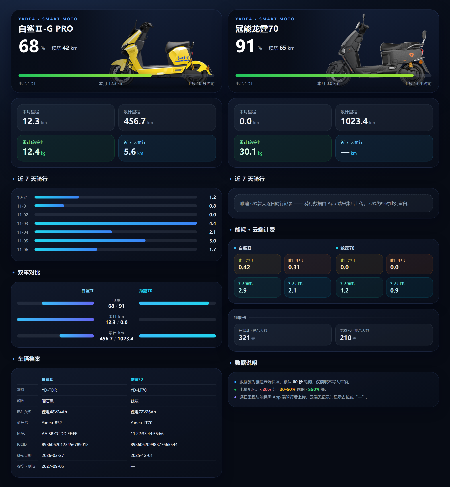
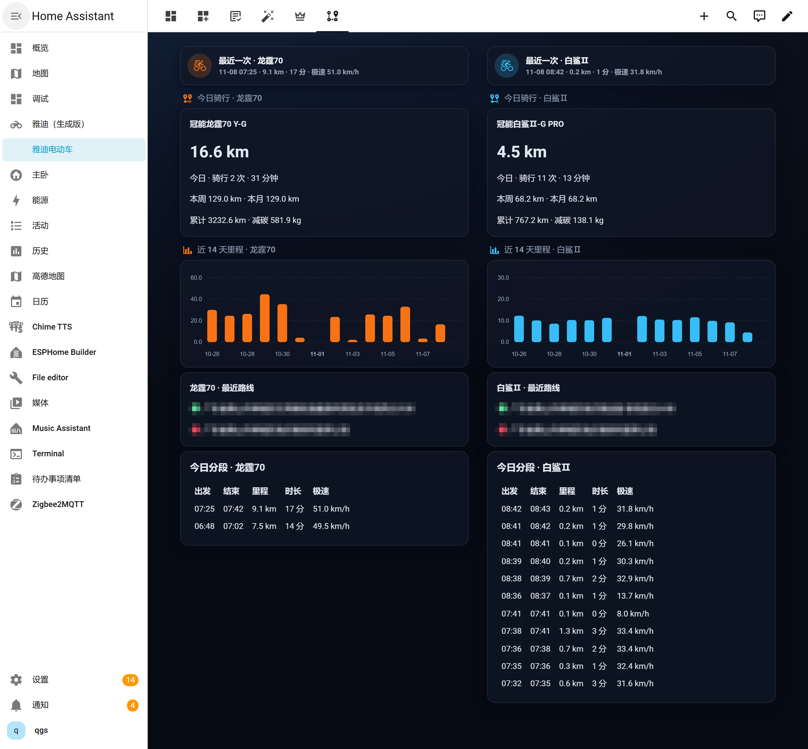

# Yadea (雅迪智行) for Home Assistant

非官方的 Home Assistant 自定义集成，通过雅迪智行云端 API 读取绑定车辆的实时状态
与**云端骑行记录**（里程 / 轨迹统计）。

> **English**: An unofficial Home Assistant custom integration for Yadea electric
> scooters, reading real-time vehicle status and cloud ride records
> (mileage / track statistics) from the Yadea Smart (雅迪智行) cloud.

## 功能特性

- ✅ 账号密码登录（雅迪智行 App 同款账号）
- ✅ 多车辆支持：账号下所有绑定车辆各建一个设备
- ✅ **云端骑行数据**：今日/本周/本月/累计里程、骑行次数与时长、最近一次骑行
  （时间/里程/极速/起终点地址）、近 31 天逐日里程
- ✅ 双档刷新：车辆状态 60 秒轮询，轨迹统计每 5 分钟同步（均可调）
- ✅ Token 持久化，重启不重新登录；token 失效走重新授权流程（默认不自动重登，
  避免把手机 App 顶下线）
- ✅ 中英文界面

### 每台车提供的传感器

| 实体 | 说明 | 来源 |
|---|---|---|
| 电量 (battery) | 电池 SOC（%） | 车辆快照 `soc1` |
| 剩余里程 (range) | km | 车辆快照 `remMileage` |
| 最后上报时间 (last_report) | 云端快照时间 | 快照 `updateTime` |
| 电池数量 / 物联卡天数 / 到期日 / 车辆信息 | 诊断实体 | 车辆快照 |
| **今日里程** (today_mileage) | km，附今日分段明细属性 | `track-ride/summary` |
| **本周里程** (this_week_mileage) | km（周一至今） | `track-ride/summary` 按日累加 |
| **本月里程** (mileage_this_month) | km，附当月逐日属性 | `track-ride/summary` |
| **累计里程** (total_mileage) | km（与 App「累计总里程」一致） | `track-ride/calc/co2` |
| **累计碳减排** (total_co2_saved) | kg | `track-ride/calc/co2` |
| 今日骑行次数 (today_rides) | 次 | `track-ride/summary` |
| 今日骑行时长 (today_ride_time) | 分钟 | `track-ride/summary` |
| 最近一次骑行 (last_ride) | 开始时间，附里程/时长/极速/起终点地址属性 | `track-ride-detail/page-list` |
| 最近一次骑行里程 / 时长 / 极速 (last_ride_*) | km / 分 / km/h | 同上 |
| 最近一次骑行路线 (last_ride_route) | 起终点地址文本 | `track-ride-detail/lon-lat` |
| **最后位置** (device_tracker) | 最近一次骑行终点的经纬度 + 地址，可上地图 | `track-ride-detail/lon-lat` |
| 近 7 天里程明细 (daily_mileage) | 诊断实体，7 天合计 + 逐日属性（含 31 天） | `track-ride/summary` |
| 昨日用电 / 充电 / 近 7 天用电 / 充电 | kWh | `batt-power-record/statistics/page` |

> **轨迹数据归属**：骑行记录按**账号**存储，只有车主账号（`primaryUser=true`）
> 能查到；家人共享账号查询返回 0 条。想让 HA 拿到轨迹，请用车主账号登录集成。
>
> 已知脏数据：云端偶发单段耗电为负、GPS 抖动切出 0.1 km 碎片段，集成不做修正。

此外每台车还有一个 **图片实体 (image)**：车辆官方车型图（`imgUrl`）。

### 仪表盘美化示例

仓库里的 [`dashboard-example.yaml`](dashboard-example.yaml) 含 6 个视图，**统一深色主题**：

| 视图 | path | 内容 | 依赖 |
|---|---|---|---|
| 总览 · 经典 | `classic` | 车辆图 + 双仪表盘 + 里程实体 + 能耗列表 | card-mod |
| 精简总览 | `compact` | 每车 6 枚悬浮标签 + 磁贴矩阵（sections 4 列） | card-mod |
| 状态速览 | `glance` | 双车图文融合大图（panel 视图） | card-mod |
| 进阶版 | `advanced` | mushroom hero + chips + mini-graph 趋势 | card-mod + mushroom + mini-graph-card |
| 旗舰版 | `pro` | HUD 控制台：hero 大数字、近 7 天骑行柱状图、双车对比、能耗与车辆档案 | card-mod + mushroom + apexcharts-card + bar-card |
| 骑行轨迹 | `track` | 双车对称两列：今日里程大数字、近 14 天柱状图、最近路线、今日分段明细表 | card-mod + mushroom + apexcharts-card |

安装 [card-mod](https://github.com/thomasloven/lovelace-card-mod) 等前置卡片后，把
`dashboard-example.yaml` 整段贴进「设置 → 仪表盘 → 添加仪表盘 → YAML 模式」，
按自己车辆替换实体 ID 前缀即可。

> **开箱即用版本**：[flyqgs/yadea-dashboard](https://github.com/flyqgs/yadea-dashboard)
> 是本仪表盘的「市场安装版」——通过 HACS / Marketplace 安装后，作为 Dashboard
> 策略自动发现车辆并生成视图，无需替换实体前缀，还可「接管控制」自由编辑。





### ⚠️ 关于账号互踢（重要）

雅迪云端**同一账号只允许一个活跃会话**：任何一次新登录（HA 或手机 App）都会让
另一端的 token 立即失效。

- 集成默认**不自动重登**：token 失效时轨迹实体会显示「不可用」，并在集成页弹出
  「重新授权」提示，由你确认后再登录（此刻手机 App 会掉线一次）。
- 如需 HA 完全自动恢复，可在集成「选项」里勾选 **自动重新登录**（代价是手机 App
  会被顶下线）。
- 「选项」里还可以直接**换账号**（填写新的手机号/密码），entry 与实体 ID 都不会变。

### 车辆位置

云端**没有实时定位接口**（`bikeRealStatus/getVehRealStatus` 在车辆休眠时返回空，
车辆熄火后不上报坐标）。因此集成提供的是**最近一次骑行结束时的停车位置**：

- 取最近一段轨迹的最后一个 GPS 点，生成 `device_tracker.<车辆>_最后位置`
- 状态为 `home` / `not_home`（按 `zone.home` 半径判断），属性含 `latitude` /
  `longitude` / `address`（地址文本）/ `location_time` / `ride_id`
- 地图卡片可直接添加该实体；车辆骑行中会随轨迹刷新（默认 5 分钟）更新

### 暂不支持

- ❌ **实时** GPS 定位：云端只在骑行过程中记录轨迹点，熄火后不再上报，
  故只能取到"最后一次停车位置"而非当前位置
- ❌ 控制（锁车/解锁/寻车）：涉及指令签名，尚未逆向

## 安装

1. 将 `custom_components/yadea/` 文件夹复制到 Home Assistant 配置目录下的
   `custom_components/yadea/`（HAOS 可用 Samba share 或 File editor）。
2. 重启 Home Assistant。
3. **设置 → 设备与服务 → 添加集成 → 搜索 "Yadea"**。
4. 输入雅迪智行 App 的手机号和密码（建议用**车主账号**，否则没有轨迹数据）。
5. （可选）在集成「选项」中调整状态轮询间隔、轨迹刷新间隔与重登策略。

依赖 `pycryptodome`，首次加载时自动安装。

## 自动化示例：低电量提醒

```yaml
automation:
  - alias: 电动车低电量提醒
    trigger:
      - platform: numeric_state
        entity_id: sensor.my_ebike_battery   # 换成你的实体 ID
        below: 20
    action:
      - service: notify.mobile_app_your_phone
        data:
          message: "电动车电量低于 20%，请及时充电"
```

## 技术原理

集成通过逆向雅迪智行 App / H5 的云端通信实现，要点见 [docs/API.md](docs/API.md)：

- 登录走 `tspapph5.yadeaiot.com.cn/prod-api/user/loginByPassword`（纯 JSON）
- 车辆与轨迹数据走网关签名通道：`gatewaySign` = Base64(AES-128-ECB 加密的
  `gatewayTimestamp={毫秒时间戳}&json={payload}`)
- **参数只放在签名里，URL 不带 query / body**（H5 拦截器把 `params`/`data` 置空；
  带 query 会导致所有 `/vehicle-base/*` 接口报「车架号不存在」）
- 轨迹接口：`track-ride-detail/page-list`（按天分组）、`track-ride/summary`
  （日/周/月聚合）、`track-ride/calc/co2`（累计里程/减碳）、
  `track-ride-detail/lon-lat`（历史 GPS 点与起终点地址）

## 免责声明 / Disclaimer

- 本项目与雅迪（Yadea）官方**无关**，"雅迪/Yadea" 及相关商标归其权利人所有。
  This project is not affiliated with or endorsed by Yadea Technology Group.
- 接口为逆向所得，**雅迪可能随时变更导致失效**，不保证可用性。
- 仅用于读取**自己名下车辆**的数据；请勿用于任何违规用途。
- 请勿将凭据（手机号/密码）分享给他人；轮询间隔请勿设置过低，避免给官方服务
  造成压力。

## License

[MIT](LICENSE)
